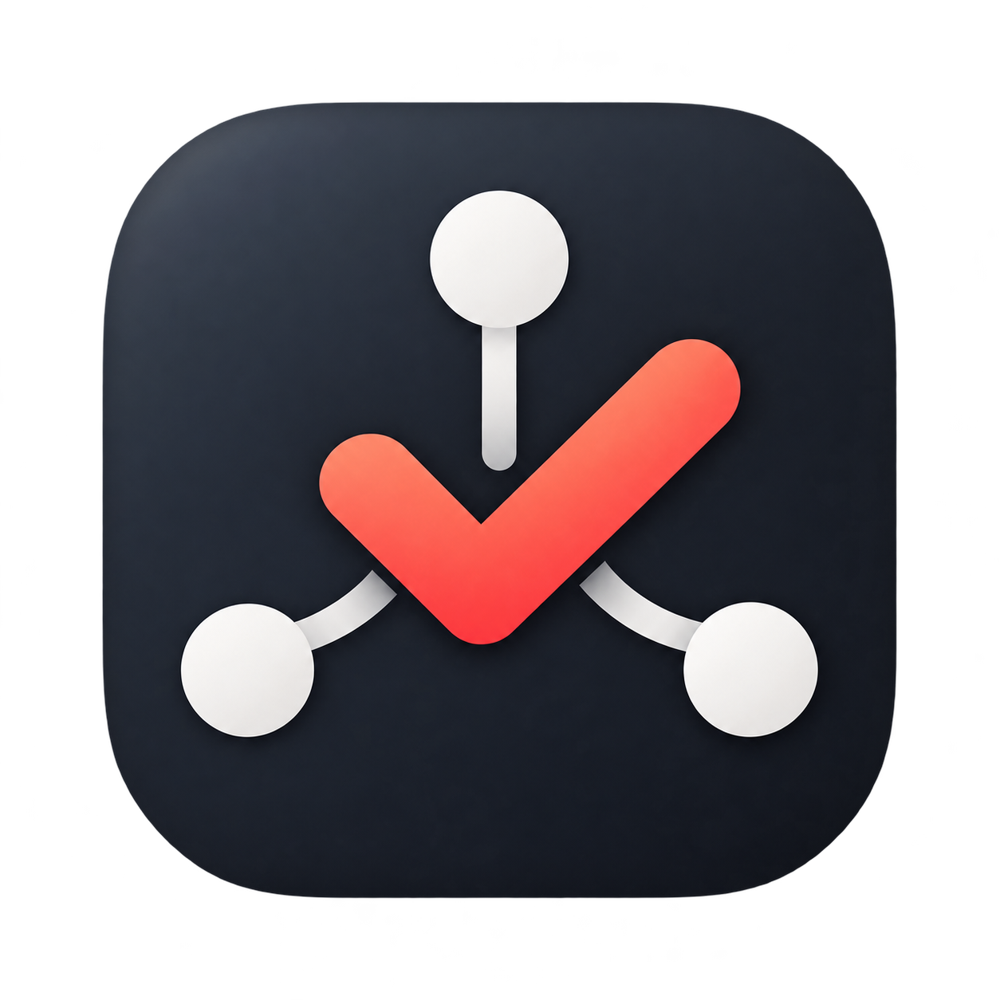

<div align="center">
  

  # AI Checklist Hub

  **把邮件、自然语言和文件中的行动事项，整理成真正可执行的任务清单。**

  本地优先 · 多格式/目录导入 · 强制 LLM 智能规划 · Gmail 只读同步 · Windows 桌面应用
</div>

AI Checklist Hub 是一个面向 Windows 的本地任务管理应用。它既可以像普通待办工具一样手动管理计划、清单和任务，也能从文本、Markdown、JSON、Webhook 以及 Gmail 中识别行动事项，经过预览或规则判断后写入清单。

应用默认把数据保存在本机。Gmail 同步采用增量游标与邮件唯一 ID 账本：已扫描的邮件不会被重复下载、分类或创建任务，从而减少请求次数和重复消耗。

## 目录

- [主要功能](#主要功能)
- [工作方式](#工作方式)
- [第二版：资料导入与按天规划](#第二版资料导入与按天规划)
- [快速开始](#快速开始)
- [Gmail 任务同步](#gmail-任务同步)
- [LLM Provider 配置](#llm-provider-配置)
- [导入与 Webhook](#导入与-webhook)
- [配置参考](#配置参考)
- [数据隐私与备份](#数据隐私与备份)
- [项目结构与技术栈](#项目结构与技术栈)
- [API 概览](#api-概览)
- [开发测试与构建](#开发测试与构建)
- [常见问题](#常见问题)

## 主要功能

### 任务与计划

- 使用 `Plan → Checklist → Item` 组织计划、清单和任务。
- 创建、编辑、删除、完成和恢复任务，并在清单间移动任务。
- 支持优先级、日期、备注、标签、一级子任务和全文搜索。
- 提供 Today、Upcoming、All、Inbox、历史和统计等视图。
- 支持 Light、Dark、System 三种主题，并适配“减少动态效果”系统设置。

### 智能导入

- 从粘贴文本、TXT、Markdown、JSON、HTTP API 或 Webhook 导入任务。
- 基础任务管理和 Gmail 本地过滤不依赖模型；文本智能导入和按天规划强制使用 OpenAI-compatible Provider。
- 使用 LLM 将长文本、多份资料和目录内容拆解为结构化任务与连续学习单元。
- 提供 Compact、Balanced、Detailed 三档任务粒度。
- 导入前可预览、改名、增删、合并任务，并决定是否跳过重复项。
- 使用标准化任务指纹阻止重复导入。

### Gmail 自动任务同步

- 通过 OAuth 2.0 连接 Gmail，仅申请 `gmail.readonly` 权限。
- 自动排除常见广告、促销、验证码和低价值通知。
- 高置信度任务邮件可自动进入清单；不确定邮件进入候选区等待确认。
- 首次进行有限时间窗扫描，之后使用 Gmail `historyId` 只检查新增邮件。
- 以 Gmail 账户和邮件 ID 建立本地唯一账本，避免同一邮件被多次处理。
- 扫描周期按小时设置，支持 1～168 小时。

### 本地优先与安全

- 使用本地 SQLite 持久化任务数据。
- Gmail OAuth 凭据、令牌和应用内录入的 API Key 使用 Windows DPAPI 加密。
- Gmail 先在本机过滤验证码和明显广告；任务及不确定邮件的完整正文发送给已启用的 LLM Provider，经过 AI 理解和拆解后再入库。
- 服务默认只监听 `127.0.0.1`，不会直接暴露到局域网。

## 工作方式

```text
手动输入 / 文件 / Webhook / Gmail
                │
                ▼
       本地过滤与内容标准化
                │
       ┌────────┴────────┐
       ▼                 ▼
  本地预处理器       强制 LLM Agent
       └────────┬────────┘
                ▼
       Schema 校验与重复检测
                │
       ┌────────┴────────┐
       ▼                 ▼
   预览后确认       受信任自动入库
                │
                ▼
       Plan → Checklist → Item
```

所有导入来源最终都转换为同一套领域模型。购物、旅行、会议行动项、软件发布和学习计划不需要各自维护一套任务表。

## 第二版：资料导入与按天规划

第二版可以一次选择多个文件，也可以选择整个目录。应用在本机提取内容与媒体时长，先展示资料清单，再由已启用的 LLM 分析主题、顺序、依赖和学习单元，最后由本地排程器按照指定天数生成每日任务。

支持格式：

| 类型 | 格式 | 提取内容 |
| --- | --- | --- |
| 文本 | TXT、Markdown、LOG | 正文、标题和列表 |
| 结构化文本 | JSON、CSV、TSV | 对象、数组、表头和有效数据行 |
| 网页 | HTML、HTM | 去除脚本和样式后的正文 |
| 文档 | PDF、DOCX | 页面文本、段落、列表和表格 |
| 演示文稿 | PPTX | 幻灯片标题与正文 |
| 工作簿 | XLSX | 工作表和有效单元格 |
| 字幕 | SRT、VTT | 时间段和字幕正文 |
| 视频 | MP4、MKV、MOV、WebM、M4V | 使用本地 FFprobe 读取准确时长 |
| 音频 | MP3、M4A、WAV、FLAC、AAC、OGG | 使用本地 FFprobe 读取准确时长 |

规划时可以设置：

- 开始日期和计划天数；
- 每日可用时间（小时和分钟均可直接输入，也可选择常用值）；
- 是否在周末安排任务；
- 需要排除的日期；
- 轻量、标准或深入学习强度；
- 复习和缓冲比例；
- 是否允许拆分长媒体与长文档；
- 可选的任务或学习目标；留空时由模型根据所选资料自动概括。

LLM 是智能规划的强制条件。缺少已启用的 Provider、API Key、网络连接，或模型没有返回合格的结构时，规划会明确停止，不会退回本地规则伪造结果。LLM 负责理解语义，本地规划器负责日期、顺序、媒体连续区间、容量计算、负载提示以及遗漏/重复校验。

从 2.0.1 起，LLM 返回的来源范围会与本机提取结果交叉校验：越界页码和媒体时间会被修正，媒体学习时长会根据实际时长与学习强度重新计算，重复单元 ID 会被规范化。每日分配采用保持学习顺序的连续分区，在不割裂内容的前提下尽量降低最高单日负载；复习分钟会精确分配，不会因逐日取整而丢失。

2.0.2 优化了规划表单：每日可用时间使用“小时 + 分钟”组合输入，计划预览也以小时/分钟显示；排除日期改为可展开的月历多选，并支持已选日期标签、单项移除和一键清空。模型要求继续保留在本文档中，应用主界面不再重复展示强制条件提示。

2.0.3 将每日可用时间升级为可输入、也可从常用值中选择的组合控件，小时支持 0～24，分钟支持 0～59，并修复了窄面板中数值被单位挤压的问题。主内容区、双列表单、资料列表、文本区域和编辑弹窗也改为更灵活的响应式或可调整尺寸布局；窄窗口不再因桌面侧栏外边距产生水平滚动。

2.0.4 将规划表单中的“学习目标”扩展为可选的“任务/学习目标”。用户可以填写任务结果或学习诉求，也可以留空；留空时，模型会根据选中的资料自动概括总体目标并继续生成计划。

2.0.5 修复了重复添加同名 Provider 时出现 `Internal Server Error` 的问题：前后端现在都会检测大小写不敏感的同名配置，并提示直接更新已有 Provider；新增配置成功后表单会清空。规划面板改为根据自身可用宽度响应式换行，窗口或分栏较窄时，“学习强度”会自动移至下一行，不再溢出到面板外。

2.1.0 面向数十 GB 的大型资料重构了导入链路。前端会先读取媒体元数据：能取得时长的音视频只建立索引，不复制几十 GB 的原文件；文本与办公文档使用 8 MB 分块串行传输，失败分块自动重试，服务端每次最多接收 16 MB。界面显示总体进度、当前文件、文件数、传输速度、预计剩余时间和取消按钮。服务端会在开始前检查临时磁盘空间，总批次上限为 256 GB；大文本采用跨文件位置的有界采样，避免把 3 GB 正文完整放入内存或数据库，同时让 LLM 摘录覆盖开头、中间和结尾。

2.1.1 修复了可调整侧栏和中等宽度窗口下的规划页面横向溢出：主内容宽度现在明确扣除侧栏宽度，资料/规划双栏会在 1500px 以下可靠改为单列；“学习强度”固定占用独立整行，不再与小时/分钟控件争抢宽度；规划选项的勾选框也会紧邻说明文字。实际 50 GB 场景基准（3 GB 文本真实传输 + 47 GB 视频元数据索引）在测试设备上用时 36.1 秒，文本吞吐 98.4 MiB/s，跟踪到的 Python 峰值内存约 18 MB，完成后 3 GB 临时缓存已全部删除。实际速度取决于磁盘和杀毒软件。

2.1.3 修复大型自动规划清单在任务总量超过单次读取上限后出现“侧栏有数量、主区域为空”的问题；任务现按 1000 项分页完整加载。自动导入和智能规划创建的任务可在清单中直接编辑标题、日期、预计小时/分钟、清单、优先级、标签、说明、完成标准与备注。规划时间范围支持“开始日期 + 天数”和“开始日期 + 结束日期”两种模式，超出计划容量的资料仍会完整保留为可编辑任务。

2.1.2 修复目录导入遇到隐藏或开发目录时中断整个批次的问题。`.git`、`.svn`、`.venv`、`node_modules`、`__pycache__`、构建产物目录以及其他点号开头的子目录现在会被自动登记为“已跳过”，其余资料继续正常上传和解析；`..` 路径穿越、绝对路径等真正不安全的路径仍会被严格拒绝。

文件内容不会被复制到安装目录。应用保存文件哈希、相对路径、提取文本和媒体元数据；原始视频、音频和办公文件不会写入 SQLite。需要分块提取的文档会暂存在 `%LOCALAPPDATA%\AI Checklist Hub\upload-cache`，成功、取消或失败后删除；可直接读取时长的媒体不会进入该缓存。发送给 LLM 的是选中文档的必要代表性文本、文件结构和媒体元数据，而不是媒体二进制内容。

## 快速开始

### 环境要求

- Windows 10 或 Windows 11
- Python 3.12 或更高版本
- Node.js 20 或更高版本
- Microsoft Edge WebView2 Runtime（Windows 10/11 通常已经安装）

### 1. 首次安装

在项目根目录双击或运行：

```bat
setup.bat
```

该脚本会自动：

1. 创建项目专用 Python 虚拟环境 `.venv`；
2. 安装后端与桌面端依赖；
3. 执行数据库迁移；
4. 安装前端依赖并生成 production build；
5. 构建 Windows 桌面应用。

### 2. 启动桌面版

```bat
start-app.bat
```

桌面版使用独立 WebView2 窗口，内部服务会选择随机可用的本机端口，并在窗口关闭后停止。

### 3. 使用备用 Web 模式

```bat
start.bat
```

随后访问：

- 应用：<http://127.0.0.1:8000>
- OpenAPI 文档：<http://127.0.0.1:8000/api/docs>
- 健康检查：<http://127.0.0.1:8000/api/health>

## Gmail 任务同步

### 扫描策略

Gmail 同步分为首次扫描和增量扫描：

| 阶段 | 扫描范围 | 防重复方式 |
| --- | --- | --- |
| 首次扫描 | Inbox 最近 1～90 天，最多 500 封；默认排除 Spam、Trash 和 Promotions | 每封邮件在下载正文前检查并登记 `(account_email, message_id)` |
| 后续扫描 | 使用 Gmail `historyId` 获取自上次成功同步以来新增到 Inbox 的邮件 | 唯一账本继续兜底，历史记录重叠也不会重复处理 |
| 游标失效恢复 | 回退到有限时间窗扫描 | 仍先检查唯一账本，已登记邮件不会重新下载或分类 |

同步过程带有进程级锁，手动同步和后台定时同步不会并发处理同一批邮件。已经登记的邮件在应用重启后仍保持已处理状态。

> 首次扫描会登记范围内的邮件。此后修改过滤规则或置信度，不会自动重新处理这些历史邮件。这是为了节省资源并保证幂等性。

### 邮件如何进入任务清单

- 广告、促销、验证码、订阅简报等明显非任务邮件会在本机直接忽略。
- 包含明确行动要求，例如“请提交”“请回复”“请确认”“请审核”“请支付”或截止日期的邮件，会被判断为任务候选。
- 当“高置信度任务自动入库”开启且置信度达到阈值时，任务直接写入清单。
- 语义不明确的邮件进入候选区，由用户选择“接受”或“忽略”。
- 创建的任务保留 Gmail message ID、thread ID 和原邮件链接，便于回溯。

### 配置 Google Cloud OAuth

1. 打开 [Google Cloud Console](https://console.cloud.google.com/) 并创建或选择项目。
2. 在 **API 和服务 → 库** 中启用 **Gmail API**。
3. 配置 **Google Auth Platform / OAuth consent screen**：
   - 个人 Gmail 账户通常选择 **External**；
   - 应用处于 Testing 状态时，把实际登录的 Gmail 地址加入 **Test users**；
   - 添加 Gmail 只读权限 `https://www.googleapis.com/auth/gmail.readonly`。
4. 在 **Clients / 凭据** 中创建 OAuth 客户端，应用类型必须选择 **Desktop app**。
5. 复制 Client ID 和 Client Secret。
6. 打开 AI Checklist Hub 的 **设置 → Gmail 任务同步**，保存 Client ID 和 Client Secret。
7. 点击 **连接 Gmail（只读）**，在浏览器中使用已加入测试用户的账号授权。
8. 返回应用，点击 **立即同步**。

桌面客户端使用本机动态回调端口，例如：

```text
http://127.0.0.1:<随机端口>/api/integrations/gmail/oauth/callback
```

使用 **Desktop app** 类型时，无需把每一个随机端口手动加入重定向 URI。不要创建 Web application 类型来代替桌面客户端。

### 推荐同步设置

| 设置 | 默认值 | 范围 | 建议 |
| --- | ---: | ---: | --- |
| 扫描间隔 | 1 小时 | 1～168 小时 | 普通个人邮箱可设为 1～3 小时 |
| 首次回看天数 | 14 天 | 1～90 天 | 邮件较多时保持 7～14 天 |
| 自动导入置信度 | 0.90 | 0.70～1.00 | 希望更谨慎时提高到 0.95 |
| 高置信度任务自动入库 | 开启 | 开 / 关 | 首次使用可关闭，先观察候选结果 |
| 首次扫描排除促销分类 | 开启 | 开 / 关 | 建议保持开启 |

### 解决 `错误 403: access_denied`

如果 Google 授权页显示 `access_denied`，依次检查：

1. OAuth Audience 是否为 External；
2. 应用处于 Testing 时，当前 Gmail 地址是否已经加入 Test users；
3. OAuth 客户端类型是否为 Desktop app；
4. Gmail API 是否已在当前 Cloud 项目中启用；
5. 应用中填写的 Client ID 和 Client Secret 是否来自同一个项目；
6. 保存设置后是否重新点击了“连接 Gmail”。

Google OAuth 应用处于 External + Testing 状态时，测试用户授权可能需要定期重新进行。若应用只供个人使用，可以继续使用测试模式；正式分发时应按 Google 的要求配置发布状态和验证。

### 断开 Gmail

在设置页点击断开连接会移除本机保存的 Gmail 令牌与连接状态。已经创建的任务和已登记邮件账本不会被删除，以免重新连接后重复创建任务。

## LLM Provider 配置

LLM 不是基础任务管理的必需条件。没有 API Key 时，任务 CRUD、搜索、统计、Gmail 本地过滤和重复检测仍然可用；文本智能导入、责任主体分析以及第二版按天规划必须使用已启用且已保存 API Key 的 Provider。

### 在应用中配置

1. 打开 **设置 → LLM Provider**。
2. 填写服务名称、Base URL、Model 和 API Key。
3. 勾选启用并保存。
4. 点击 **测试连接** 验证配置。

应用支持与 OpenAI Chat Completions 风格接口兼容的 Provider。API Key 使用 Windows DPAPI 加密保存，不写入 SQLite，设置接口也不会返回密钥原文。

### 通过 `.env` 配置

复制 `.env.example` 为 `.env`，按需填写：

```dotenv
OPENAI_API_KEY=
OPENAI_BASE_URL=https://api.openai.com/v1
OPENAI_MODEL=gpt-4.1-mini
WEBHOOK_TOKEN=
```

使用自定义 Provider 时，把 `OPENAI_BASE_URL` 和 `OPENAI_MODEL` 改为服务商提供的值。不要把包含密钥的 `.env` 提交到版本控制。

### 智能解析模式

| 模式 | 行为 |
| --- | --- |
| 强制 AI | 每次都调用当前启用的 Provider；配置或请求失败时明确报错 |
| 智能模式 | 规则结果清晰时直接使用；内容模糊或涉及角色判断时再调用 LLM |
| 仅本地规则 | 不需要外部模型，适合结构清晰的列表、Markdown 和简单行动项 |

Agent v2 会识别目标、执行阶段、责任主体、步骤、子任务、依赖和条件动作。模型结果必须通过 Pydantic Schema 校验，随后再由本地逻辑进行去重、粒度规范化和顶层任务数量控制。

## 导入与 Webhook

### 支持的来源

- 应用内粘贴文本
- 多个文本、结构化数据、PDF、Office、字幕与媒体文件
- 整个资料目录（保留相对路径和目录顺序）
- REST API
- 通用 Webhook
- Gmail 同步

### 导入流程

1. 来源内容保存为 RawContent；
2. 本地预处理器整理结构；交互式智能导入由强制 LLM 转换为标准任务 Schema；
3. 本地计算重复指纹；
4. 用户在预览页修改计划、清单和任务；
5. 确认后事务式写入数据库。

重复指纹综合标准化标题、清单、计划、来源和日期计算。预览中可以跳过重复项，也可以明确选择全部导入。

### Webhook 示例

```powershell
$body = @{
  source_name = "会议纪要"
  content = "发布准备：`n确认发布窗口`n通知相关团队`n检查回滚方案"
  use_llm = $false
} | ConvertTo-Json

Invoke-RestMethod `
  -Method Post `
  -Uri http://127.0.0.1:8000/api/webhooks/import `
  -ContentType application/json `
  -Body $body
```

如果 `.env` 中设置了 `WEBHOOK_TOKEN`，请求还必须包含：

```text
X-Webhook-Token: <你的令牌>
```

## 配置参考

| 配置 | 位置 | 用途 |
| --- | --- | --- |
| Gmail Client ID / Secret | 设置 → Gmail 任务同步 | 建立 OAuth 只读连接 |
| Gmail 扫描间隔 | 设置 → Gmail 任务同步 | 每 1～168 小时检查一次新邮件 |
| 首次回看天数 | 设置 → Gmail 任务同步 | 控制首次连接时扫描的历史范围 |
| 自动导入阈值 | 设置 → Gmail 任务同步 | 控制任务邮件自动入库的谨慎程度 |
| LLM Base URL / Model / Key | 设置 → LLM Provider 或 `.env` | 启用 AI 任务拆解 |
| `WEBHOOK_TOKEN` | `.env` | 保护 Webhook 导入入口 |
| UI 主题 | 设置 | Light / Dark / System |

## 数据隐私与备份

### 数据位置

桌面版数据：

```text
%LOCALAPPDATA%\AI Checklist Hub\checklist.db
%LOCALAPPDATA%\AI Checklist Hub\secrets.json
```

- `checklist.db`：计划、清单、任务、Gmail 处理账本及应用配置。
- `secrets.json`：使用当前 Windows 用户 DPAPI 加密的 API Key、OAuth 客户端信息和令牌。

备用 Web 模式默认数据库：

```text
backend\data\checklist.db
```

首次启动桌面版时，如果发现旧的 `backend\data\checklist.db`，应用会通过 SQLite Backup API 迁移一次。此后重新构建或移动程序不会覆盖 `%LOCALAPPDATA%` 中的数据。

### 隐私边界

- Gmail 权限为只读，应用不会发送、删除、归档或标记邮件。
- Gmail 的任务及不确定邮件会发送给当前启用的 LLM Provider；自动入库与候选确认均必须经过模型处理。模型失败时保留为候选并显示错误，不会降级为规则任务。
- Provider Key 和 OAuth 令牌不会以明文写入数据库或通过设置 API 返回。
- 本地服务默认绑定 `127.0.0.1`。

如果需要把 Web 服务暴露到其他设备，请自行增加 TLS、身份认证和严格的 Webhook Token；项目默认配置不面向公网部署。

### 备份

先关闭应用，再运行：

```bat
backup.bat
```

备份文件会写入项目根目录的 `backups\`。脚本优先备份桌面版数据库，如果不存在则备份 Web 模式数据库。

> `secrets.json` 只能由创建它的 Windows 用户解密。移机时建议在新电脑重新填写 API Key 并重新授权 Gmail，而不是依赖复制密钥文件。

## 项目结构与技术栈

```text
AI-Checklist-Hub/
├─ assets/                 # 应用图标
├─ backend/
│  ├─ alembic/             # 数据库迁移
│  ├─ app/
│  │  ├─ api/              # REST API
│  │  ├─ core/             # 配置、数据库、密钥存储
│  │  ├─ models/           # SQLAlchemy 模型
│  │  ├─ schemas/          # Pydantic Schema
│  │  └─ services/         # Parser、Import、Gmail、Source Adapter
│  └─ tests/               # pytest 测试
├─ desktop/                # pywebview 桌面启动器
├─ frontend/               # React + TypeScript + Vite
├─ .env.example
├─ backup.bat
├─ build-desktop.bat
├─ setup.bat
├─ start-app.bat
└─ start.bat
```

| 层 | 技术 |
| --- | --- |
| Frontend | React、TypeScript、Vite、Lucide Icons |
| Backend | FastAPI、SQLAlchemy 2、Pydantic 2、HTTPX |
| Database | SQLite、Alembic |
| Desktop | pywebview、PyInstaller、WebView2 |
| Tests | pytest、FastAPI TestClient |

## API 概览

所有业务端点都以 `/api` 开头。

| 功能 | 端点 |
| --- | --- |
| 健康检查 | `GET /api/health` |
| 任务 | `GET/POST /api/items`、`PUT/DELETE /api/items/{id}`、`POST /api/items/{id}/complete` |
| 清单 | `GET/POST /api/lists`、`PUT/DELETE /api/lists/{id}` |
| 计划 | `GET/POST /api/plans`、`PUT/DELETE /api/plans/{id}` |
| 分类与统计 | `GET /api/categories`、`GET /api/stats` |
| 导入 | `POST /api/import/parse`、`/actors`、`/file`、`/confirm` |
| 多文件/目录批次 | `POST /api/import/batches`、`GET/DELETE /api/import/batches/{id}` |
| 强制 LLM 智能规划 | `POST /api/planning/schedule`、`POST /api/planning/confirm` |
| Webhook | `POST /api/webhooks/import` |
| Provider | `GET/POST /api/settings/providers`、`PUT/DELETE /api/settings/providers/{id}`、`POST /test` |
| Gmail 状态与配置 | `GET /api/integrations/gmail/status`、`POST /client`、`PUT /settings` |
| Gmail OAuth 与同步 | `POST /api/integrations/gmail/oauth/start`、`GET /oauth/callback`、`POST /sync` |
| Gmail 候选 | `GET /api/integrations/gmail/candidates`、`POST /{id}/accept`、`POST /{id}/ignore` |
| 断开 Gmail | `DELETE /api/integrations/gmail` |

精确请求结构、响应 Schema 和在线调试入口请查看 `/api/docs`。

## 开发测试与构建

### 启动后端开发服务器

```bat
.venv\Scripts\python.exe -m uvicorn app.main:app --app-dir backend --reload
```

### 启动前端开发服务器

```bat
cd frontend
npm run dev
```

### 后端测试

```bat
cd backend
..\.venv\Scripts\python.exe -m pytest -q
```

### 前端类型检查与构建

```bat
cd frontend
npm run lint
npm run build
```

### 构建 Windows 桌面应用

先确保前端已构建，再运行：

```bat
build-desktop.bat
```

输出位置：

```text
desktop_dist\2.1.3\AI Checklist Hub\AI Checklist Hub.exe
```

### 构建可安装版本

安装 [Inno Setup 6](https://jrsoftware.org/isinfo.php) 后运行：

```bat
build-installer.bat
```

脚本会在桌面版产物不存在时先调用 `build-desktop.bat`，随后生成：

```text
installer_dist\AI-Checklist-Hub-Setup-2.1.3.exe
```

安装程序支持简体中文安装向导、开始菜单入口、可选桌面快捷方式以及标准卸载入口。默认采用当前用户安装，不需要管理员权限。升级或卸载只处理程序目录，不会删除 `%LOCALAPPDATA%\AI Checklist Hub` 中的任务数据库和加密设置。

桌面构建只收集运行所需的 `backend\app` 与 `frontend\dist`，不会把 `backend\data`、测试数据库或测试源码打入发布包。

简体中文安装界面使用社区维护的 [Inno Setup Chinese Simplified Translation](https://github.com/kira-96/Inno-Setup-Chinese-Simplified-Translation)，语言文件随安装脚本保存在 `installer\languages` 中，因此构建不依赖全局语言包。

### 数据库迁移

在修改 SQLAlchemy 模型后：

```bat
cd backend
..\.venv\Scripts\alembic.exe revision --autogenerate -m "describe change"
..\.venv\Scripts\alembic.exe upgrade head
```

提交模型修改时应同时提交对应的 Alembic migration。

## 扩展开发

### 新增 Source Adapter

`backend/app/services/sources.py` 中的来源适配器只负责获取原始内容：

```python
class ContentSource(ABC):
    def fetch(self) -> list[SourceContent]: ...
```

新增来源时：

1. 继承 `ContentSource`；
2. 返回一个或多个 `SourceContent`；
3. 不在 Adapter 中直接写数据库或创建领域专用任务模型；
4. 将内容交给统一 Parser；
5. 通过预览确认或明确受信任的自动路径保存。

### 新增 LLM Provider

实现与 `OpenAICompatibleProvider.parse(content) -> ParsedPlan` 相同的契约。模型返回后必须执行 `ParsedPlan.model_validate()`；Provider 只负责文本到标准 Schema 的转换，不直接操作数据库。

### 新增 Parser

Parser 应保持领域无关，并返回 `ParsedPlan`、`ParsedList` 和 `ParsedItem`。新增策略时至少补充一个正常输入、一个模糊输入和一个非目标领域回归测试。

## 常见问题

<details>
<summary><strong>启动时报错：No module named 'html.parser'</strong></summary>

请重新运行 `setup.bat` 或至少重新执行 `build-desktop.bat`。当前版本已经移除桌面打包环境中对 `html.parser` 的运行时依赖；旧的 `desktop_dist` 仍可能包含过期构建。

</details>

<details>
<summary><strong>Google 授权时报 403 access_denied</strong></summary>

最常见原因是 OAuth 应用仍处于 Testing，但当前 Gmail 地址没有加入 Test users。也请确认客户端类型是 Desktop app、Gmail API 已启用，且 Client ID/Secret 来自同一 Cloud 项目。详见上方“解决 403”章节。

</details>

<details>
<summary><strong>没有 OpenAI API Key 能否使用？</strong></summary>

可以继续使用手动任务管理、搜索、统计、Gmail 本地分类和重复检测。交互式文本智能导入、责任主体分析以及文件/目录按天规划需要已启用的 LLM Provider；缺少 Provider 时会明确提示并停止，不会生成猜测性计划。

</details>

<details>
<summary><strong>为什么同一封邮件不会再次扫描？</strong></summary>

应用在下载正文前，会把 Gmail 账户和 message ID 写入具有唯一约束的本地账本。重复手动同步、定时同步、应用重启或 Gmail history 结果重叠，都无法为同一邮件创建第二条登记记录。

</details>

<details>
<summary><strong>修改 Gmail 规则后，怎样重新处理历史邮件？</strong></summary>

当前设计把“扫描过即不重复处理”作为资源保护边界，界面不提供批量重扫。需要验证新规则时，建议先使用候选审核或新收到的测试邮件。直接修改或删除 Gmail 账本属于维护操作，执行前必须备份数据库。

</details>

<details>
<summary><strong>端口 8000 被占用怎么办？</strong></summary>

桌面版使用随机端口，通常不受影响。Web 模式需要关闭占用 8000 端口的程序，或同时修改 `start.bat` 中的服务端口与浏览器地址。

</details>

<details>
<summary><strong>为什么页面刷新后数据仍然存在？</strong></summary>

确认保存的数据位于 SQLite 中，不依赖浏览器内存。FastAPI 还会把非 API 前端路由回退到 production `index.html`，因此直接刷新应用路由不会返回 404。

</details>

<details>
<summary><strong>是否可以直接连接 ChatGPT Scheduled Tasks？</strong></summary>

当前没有依赖未公开或不稳定的任务历史接口，也没有使用网页爬虫。可将定时任务输出粘贴到导入页，或让能够访问本机服务的自动化调用 `/api/webhooks/import`。

</details>

---

AI Checklist Hub 目前以本地个人使用为主要场景。准备将它暴露到公网或分发给其他用户前，请补充身份认证、发布流程、OAuth 验证和安全审计。
